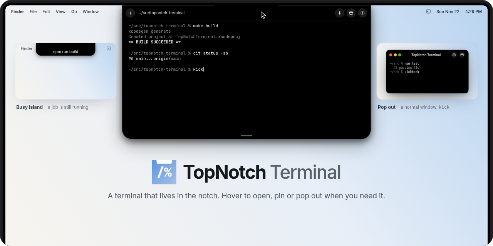
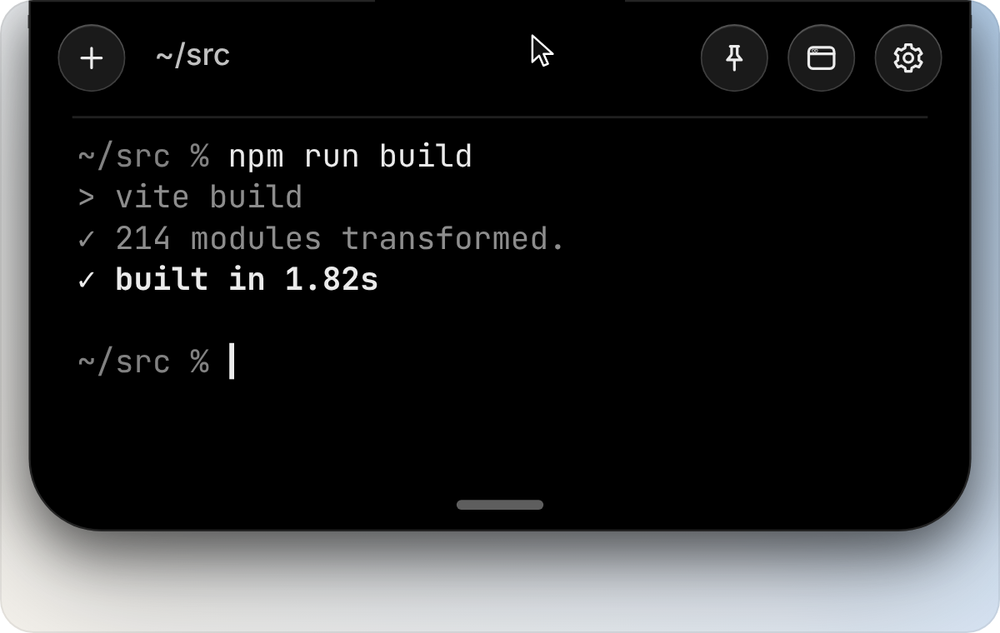
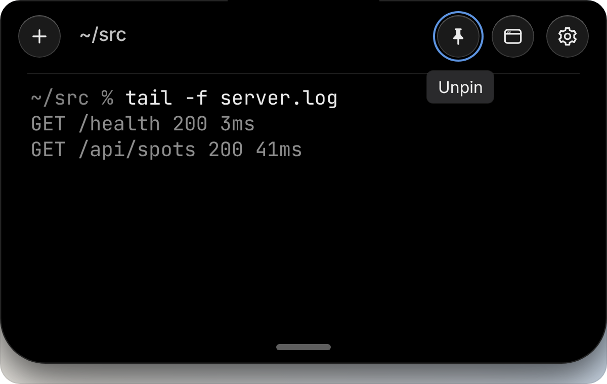
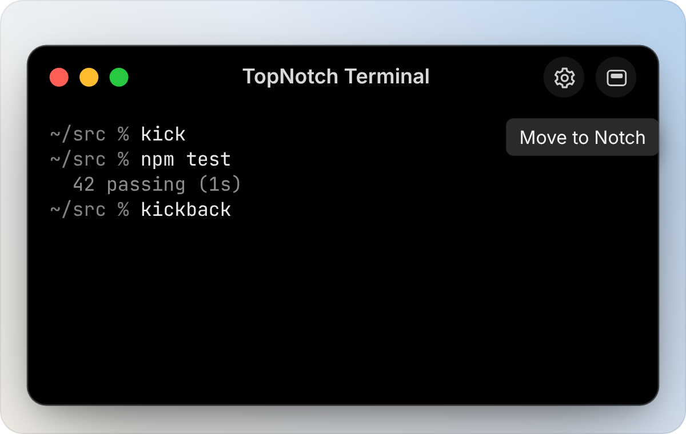
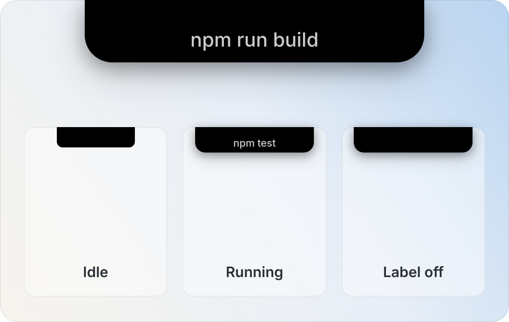
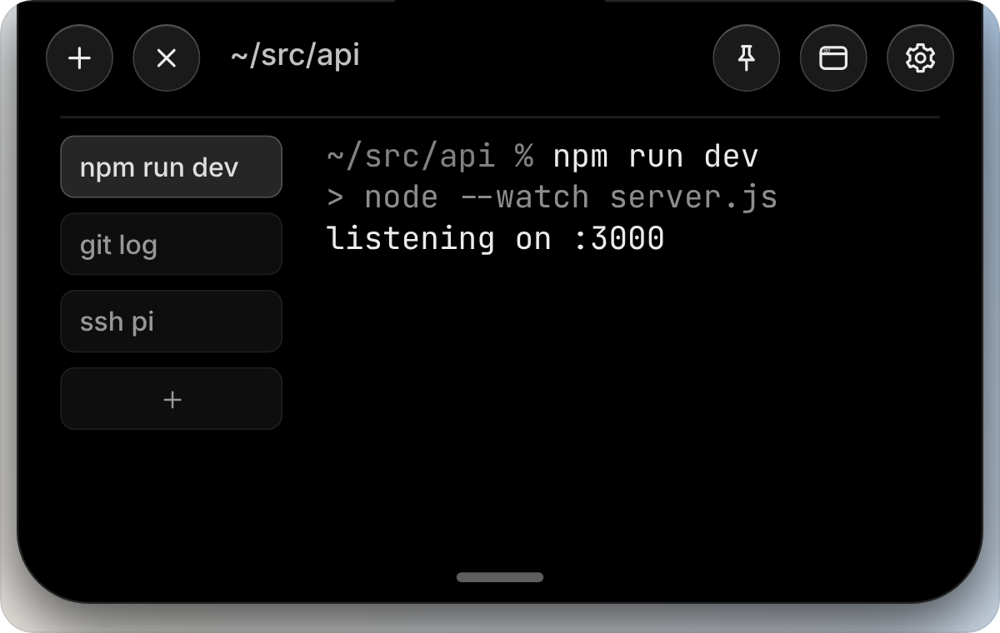
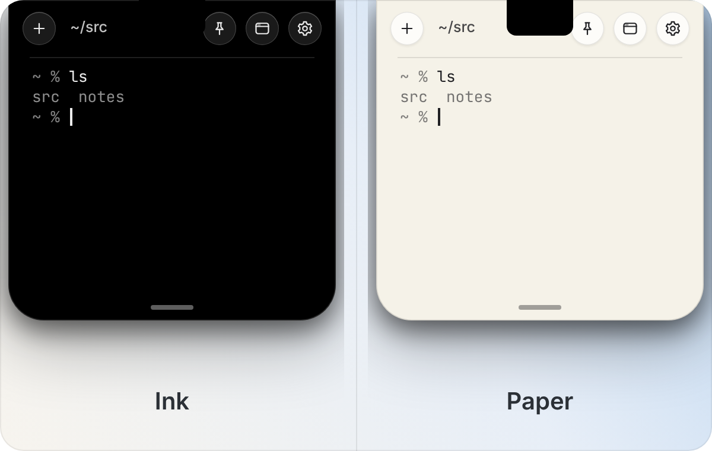

<div align="center">

<picture>
  <source media="(prefers-color-scheme: dark)" srcset="docs/readme/cover-dark.png">
  
</picture>

# TopNotch Terminal

**A terminal that lives in the MacBook notch.** Hover to open, pin or pop out when you need it.

[](https://github.com/rhagerty32/topnotch-terminal/actions/workflows/ci.yml)
[](https://github.com/rhagerty32/topnotch-terminal/releases)
[](LICENSE)


[Install](#install) · [Use](#use) · [Settings](#settings) · [Build](#build-from-source) · [Contributing](#contributing)

</div>

---

<table>
<tr>
<td width="50%" valign="top">
<picture>
  <source media="(prefers-color-scheme: dark)" srcset="docs/readme/card-hover-dark.png">
  
</picture>

### Hover to open

Point at the notch and the card springs out of it after 120 ms, with the keyboard already in the shell. Move away and it closes 400 ms later. Both delays are in Settings.
</td>
<td width="50%" valign="top">
<picture>
  <source media="(prefers-color-scheme: dark)" srcset="docs/readme/card-pin-dark.png">
  
</picture>

### Pin it open

Pin from the toolbar or the menu bar icon and the card stays put while you work in other apps. Esc still hides it when nothing is running.
</td>
</tr>
<tr>
<td width="50%" valign="top">
<picture>
  <source media="(prefers-color-scheme: dark)" srcset="docs/readme/card-popout-dark.png">
  
</picture>

### Pop out, kick back

Type `kick` (or hit the window button) to move your tabs into a normal 760 × 480 window. Type `kickback`, close the window, or press **Move to Notch** to send them home.
</td>
<td width="50%" valign="top">
<picture>
  <source media="(prefers-color-scheme: dark)" srcset="docs/readme/card-island-dark.png">
  
</picture>

### Busy island

While a command runs and the card is closed, the notch grows a little and can show the command. Hover it to open the card, or, with a popped-out window, to jump back to it.
</td>
</tr>
<tr>
<td width="50%" valign="top">
<picture>
  <source media="(prefers-color-scheme: dark)" srcset="docs/readme/card-tabs-dark.png">
  
</picture>

### Tabs

⌘T for a new tab. A vertical rail appears once there are two, named after each tab’s last command. Double-click to rename; ⌘1–⌘9 or Control-Tab to switch.
</td>
<td width="50%" valign="top">
<picture>
  <source media="(prefers-color-scheme: dark)" srcset="docs/readme/card-themes-dark.png">
  
</picture>

### Themes and type

Ink, Slate or Paper; SF Mono, Menlo, Monaco or any installed font at 9–18 pt; a block, bar or underline cursor. The card always opens black and washes into the theme.
</td>
</tr>
</table>

### Also in the box

| | |
|---|---|
| **Real shell** | Not sandboxed, so your login shell runs real tools and your `~/.zshenv` and `~/.zshrc` still load. |
| **Mac-style editing** | Shift-arrows select, ⌘A selects the command line, ⌘C / ⌘X / ⌘V work, ⌘ and ⌥ arrows jump by line or word. |
| **Summon from anywhere** | `focus`, `open topnotch://`, **Show Terminal** in the menu, or an optional global shortcut. |
| **Drag to resize** | Pull the bottom edge. It can remember the height you drag to. |
| **No notch? Still works** | Falls back to a 180-point hover strip at the top centre of the main screen. |
| **Quiet** | No Dock icon, nothing on screen while idle, and it respects Reduce Motion. |

## Install

You need **macOS 14 or later**. On a Mac without a notch, the hover target is a 180-point strip at the top centre of the main screen.

1. Download `TopNotchTerminal-<version>.dmg` from [Releases](https://github.com/rhagerty32/topnotch-terminal/releases).
2. Open the disk image and drag **TopNotch Terminal** up into the notch. That notch is the Applications folder.
3. Open the app from Applications. It has no Dock icon; look for the terminal icon in the menu bar. The very first open always shows Settings.

The build is **ad-hoc signed**, so macOS warns that it’s from an unidentified developer. Right-click the app in Applications → **Open**, or run:

```bash
xattr -dr com.apple.quarantine "/Applications/TopNotch Terminal.app"
```

<!-- TODO: once there's a Developer ID certificate and notarization, drop the Gatekeeper step. -->

## Use

| Action | How |
| --- | --- |
| Open | Hover the notch. It opens after 120 ms and the terminal has the keyboard straight away |
| Hide | Move away (closes after 400 ms), or press Esc when nothing is running |
| Pin / unpin | Pin button in the toolbar, or **Pin / Unpin** in the menu bar icon’s menu |
| Pop out to a window | Window button in the toolbar, **Pop Out** in the menu, or type `kick` |
| Back to the notch | **Move to Notch** in the window toolbar, close the window, or type `kickback` |
| Show it from anywhere | **Show Terminal** in the menu, type `focus`, `open topnotch://`, or a summon shortcut |
| New tab / close tab | ⌘T / ⌘W, or the + and × toolbar buttons. The last tab can’t be closed |
| Switch tab | ⌘1–⌘9, or Control-Tab (Shift to go back) |
| Rename a tab | Double-click it in the tab rail |
| Resize | Drag the bottom edge, or pick 420, 540 or 640 pt in Settings |
| Settings | Opens when you open the app (by default). Also ⌘, , the gear, or the menu |
| Quit | **Quit TopNotch Terminal** in the menu. Asks first if something is still running (on by default) |

Editing works like a Mac text field, not raw terminal chords. Shift-arrows grow a selection, ⌘A selects the command line, and ⌘C, ⌘X and ⌘V copy, cut and paste. ⌘←/⌘→ and ⌥←/⌥→ jump and delete by line or word.

## Settings

| Section | What you can change |
| --- | --- |
| General | What opening the app does (Show Settings by default), open at login, confirm quit while a command runs |
| Appearance | Theme (Ink, Slate, Paper), font (SF Mono, Menlo, Monaco or an installed font), size (9–18 pt, default 13), cursor (block, bar, underline), blink |
| Notch | Height (420 / 540 / 640 pt), remember a dragged height, hover open (0–400 ms) and close (50–800 ms) delays, show the running command on the island |
| Shell | Shell path (blank uses `$SHELL`), startup directory (blank uses your home folder) |
| Shortcuts | An optional global summon shortcut: ⌃⌥T, ⌥Space or ⌘⇧Space (none by default). The other chords are fixed |

Animations follow **Reduce Motion** in System Settings.

## Build from source

You need **Xcode** and **[XcodeGen](https://github.com/yonaskolb/XcodeGen)** (`brew install xcodegen`).

```bash
make open
```

That generates the project, builds Debug, quits the copy already sitting in the notch, and launches the new one. A plain `open` only wakes the old process.

If `xcodebuild` says the Metal compiler is missing:

```bash
xcodebuild -downloadComponent MetalToolchain
make open
```

| Target | What it does |
| --- | --- |
| `make generate` | `xcodegen generate` only |
| `make build` | Generate + Debug build (what CI runs) |
| `make release` | Generate + Release build |
| `make dmg` | Release build + `dist/TopNotchTerminal-<version>.dmg` |

## Contributing

Bug reports, ideas and pull requests are welcome. Read [CONTRIBUTING.md](CONTRIBUTING.md) and the [Code of Conduct](CODE_OF_CONDUCT.md) first, and use the [issue templates](https://github.com/rhagerty32/topnotch-terminal/issues/new/choose).

### How changes land

Anyone can open a pull request against `main`. CI has to pass (a Debug build on macOS 15), and only [@rhagerty32](https://github.com/rhagerty32) merges to `main`.

## License

[MIT](LICENSE) © Ryan Hagerty
